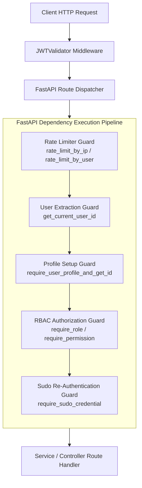
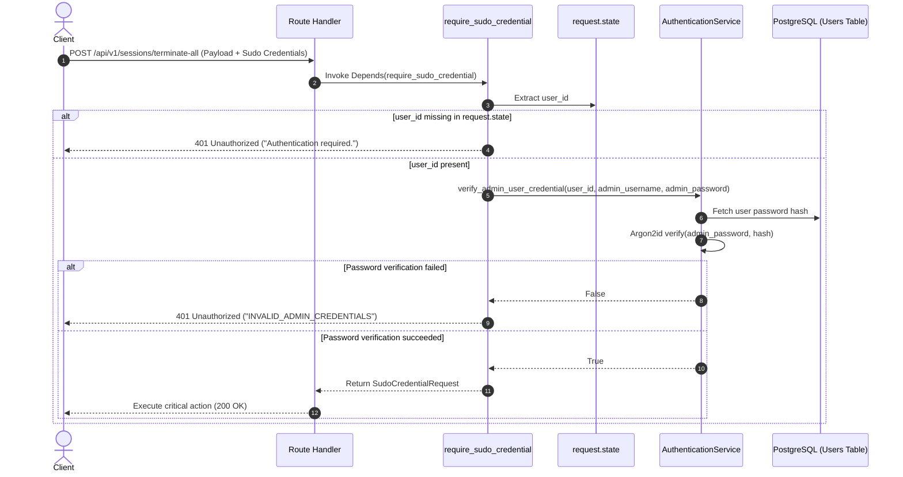
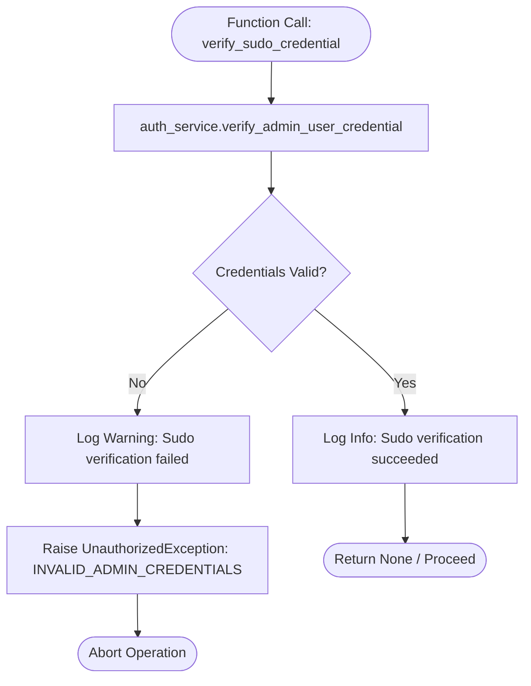
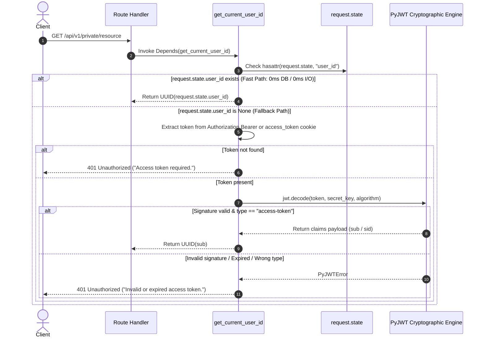
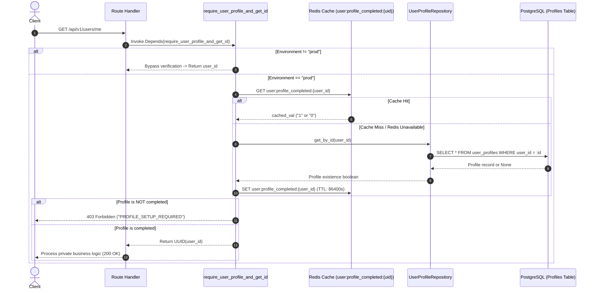
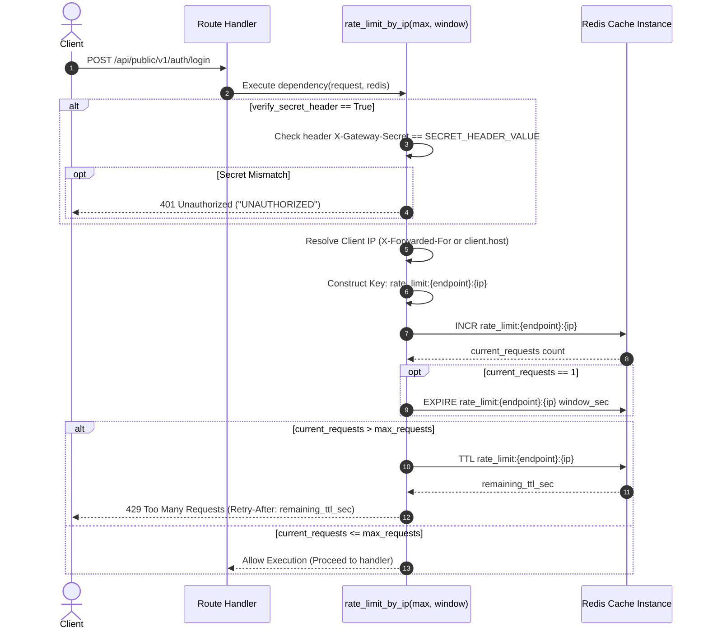
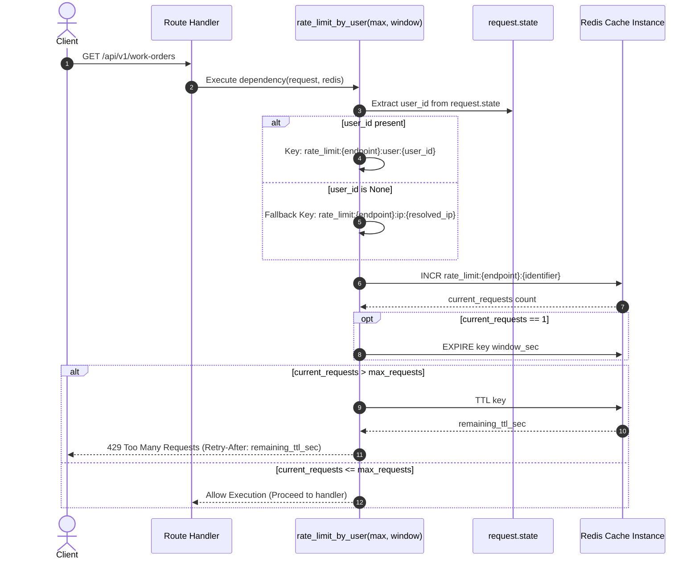
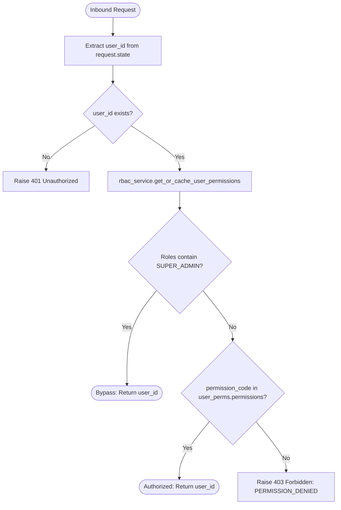
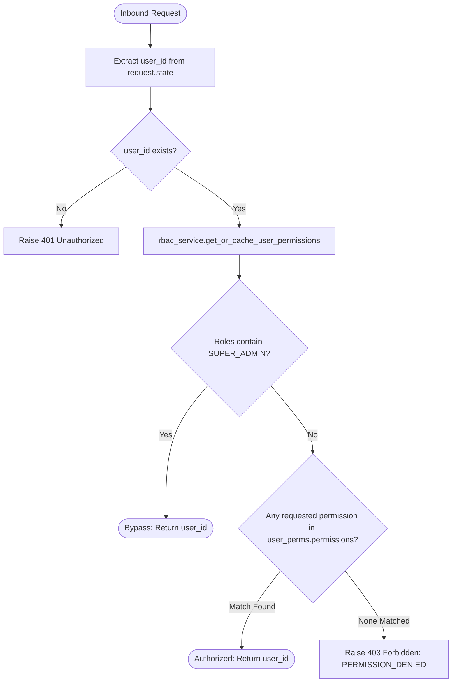
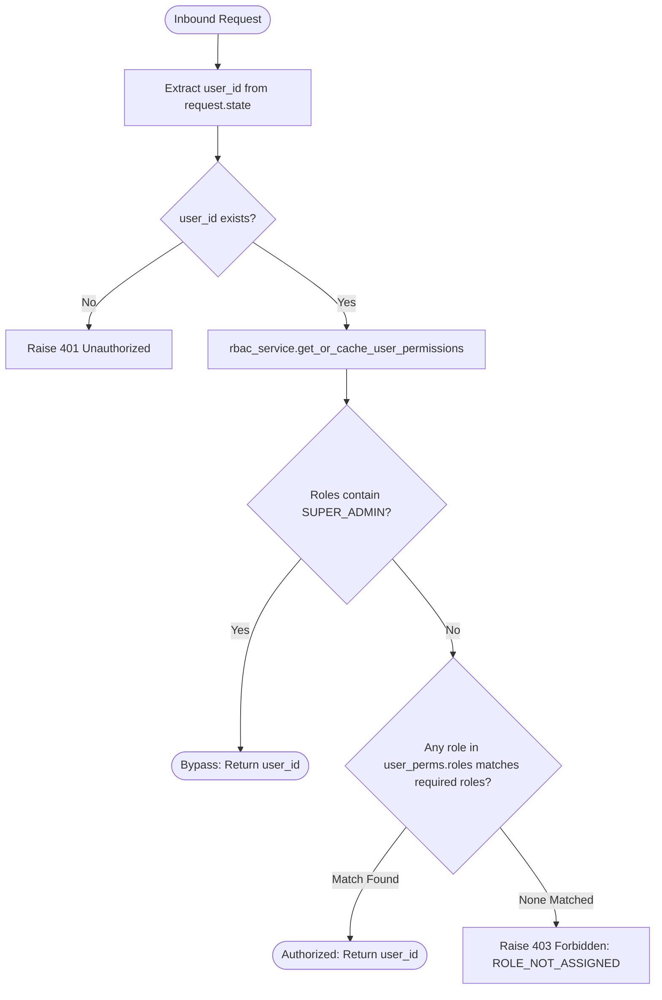

# XCOM Fast-API Dependency Architecture & Guard Documentation

> **System Architecture & Developer Reference Document**  
> **Document Status**: Production Core Specification  
> **Target Package**: [`src/dependencies/`](/src/dependencies)  
> **Coverage**: Security Guards, Request Context Extraction, ABAC Profile Verification, Redis Rate Limiting, and Zero-DB RBAC Authorization

---

## 1. Architectural Overview & Injection Pipeline

In the XCOM ERP architecture, FastAPI dependencies operate as reusable, composable request interceptors. They enforce security contracts, perform state verification, and inject domain context into route handlers before business logic executes.

Dependencies run downstream of the [`JWTValidator`](/src/middlewares/jwt_validator.py) middleware. When a request targets a protected endpoint, dependencies consume pre-validated context from `request.state` or coordinate with Redis and PostgreSQL to enforce operational constraints.



---

## 2. Dependency Catalog

| Dependency Module | Exported Functions / Callables | Primary Scope | Primary Storage / Backing |
| :--- | :--- | :--- | :--- |
| [`credential_guard.py`](/src/dependencies/credential_guard.py) | [`require_sudo_credential`](/src/dependencies/credential_guard.py#L40-L61), [`verify_sudo_credential`](/src/dependencies/credential_guard.py#L18-L38) | High-risk administrative mutations | Database (Argon2id Hash) |
| [`current_user.py`](/src/dependencies/current_user.py) | [`get_current_user_id`](/src/dependencies/current_user.py#L17-L68), [`require_user_profile_and_get_id`](/src/dependencies/current_user.py#L70-L111) | Authentication & profile readiness | `request.state` / Redis cache |
| [`rate_limit.py`](/src/dependencies/rate_limit.py) | [`rate_limit_by_ip`](/src/dependencies/rate_limit.py#L10-L69), [`rate_limit_by_user`](/src/dependencies/rate_limit.py#L71-L116) | Traffic shaping & brute-force defense | Redis Atomic Counters |
| [`rbac_guard.py`](/src/dependencies/rbac_guard.py) | [`require_role`](/src/dependencies/rbac_guard.py#L89-L122), [`require_permission`](/src/dependencies/rbac_guard.py#L16-L52), [`require_any_permission`](/src/dependencies/rbac_guard.py#L54-L87) | Role & permission authorization | Redis Set Cache / RBAC Repo |

---

## 3. Credential Guard (`src/dependencies/credential_guard.py`)

### 3.1 `require_sudo_credential`

#### Short Description
Validates step-up administrative credentials (`admin_username` and `admin_password`) against database password hashes before executing high-risk mutations.  
Ensures sensitive operations cannot be performed via compromised access tokens without active credential re-verification.

#### Data Flow Diagram


#### Specification & Parameters
- **Signature**: `async def require_sudo_credential(credential: SudoCredentialRequest, request: Request, auth_service: AuthenticationService = Depends()) -> SudoCredentialRequest`
- **Target Schema**: [`SudoCredentialRequest`](/src/dependencies/credential_guard.py#L12-L15)
  - `admin_username: str`: Identity of authorizing administrator.
  - `admin_password: str`: Active plaintext password to verify against Argon2id hash.
- **Exceptions**:
  - `401 Unauthorized` (`INVALID_ADMIN_CREDENTIALS`): In case of mismatched credentials or invalid password.
  - `401 Unauthorized` (`Authentication required.`): In case caller lacks prior session context.

---

### 3.2 `verify_sudo_credential`

#### Short Description
A reusable asynchronous helper function that directly triggers administrator credential verification through the authentication service.  
Centralizes password hash validation and structured logging, raising an `UnauthorizedException` upon any authentication mismatch.

#### Data Flow Diagram


#### Specification & Parameters
- **Signature**: `async def verify_sudo_credential(user_id: UUID, username: str, plain_password: str, auth_service: AuthenticationService) -> None`
- **Return Value**: `None` on success; raises [`UnauthorizedException`](/src/exceptions/app_exception.py) on failure.

---

## 4. Current User & Profile Guard (`src/dependencies/current_user.py`)

### 4.1 `get_current_user_id`

#### Short Description
Extracts the authenticated caller's unique `user_id` directly from pre-verified `request.state` populated by edge middleware.  
Includes an automated fallback that parses and cryptographically validates Bearer tokens or cookies if middleware state is absent.

#### Data Flow Diagram


#### Specification & Parameters
- **Signature**: `async def get_current_user_id(request: Request, credentials: Optional[HTTPAuthorizationCredentials] = Depends(security)) -> UUID`
- **Performance Characteristics**:
  - **Fast-path (Standard)**: $0\text{ms}$ I/O. Claims pre-injected into `request.state` by [`JWTValidator`](/src/middlewares/jwt_validator.py).
  - **Fallback Path**: $\approx 0.02\text{ms}$ CPU cryptographic token decoding.
- **Exceptions**:
  - `401 Unauthorized`: Missing token, invalid signature, or token type mismatch (`type != "access-token"`).
  - `500 InternalServerError`: Unexpected decoding failure.

---

### 4.2 `require_user_profile_and_get_id`

#### Short Description
Attribute-Based Access Control (ABAC) guard ensuring the authenticated user has completed their initial profile setup before accessing private endpoints.  
Evaluates cached profile completion flags from Redis with transparent fallback to the database repository on cache misses.

#### Data Flow Diagram


#### Specification & Parameters
- **Signature**: `async def require_user_profile_and_get_id(user_id: UUID = Depends(get_current_user_id), user_profile_repo: UserProfileRepository = Depends(), cache_utils: MaintainCacheKeyUtils = Depends()) -> UUID`
- **Cache Key**: `user:profile_completed:{user_id}`
- **Exceptions**:
  - `403 Forbidden` (`PROFILE_SETUP_REQUIRED`): User profile has not been initialized.
  - Passes through `401 Unauthorized` if upstream user extraction fails.

---

## 5. Rate Limiting Guards (`src/dependencies/rate_limit.py`)

### 5.1 `rate_limit_by_ip`

#### Short Description
Restricts inbound traffic volume based on client IP address using atomic Redis sliding/fixed-window counters and gateway secret verification.  
Designed for public routes and entrypoints to prevent DDoS attacks, credential stuffing, and unauthenticated endpoint abuse.

#### Data Flow Diagram


#### Specification & Parameters
- **Factory Signature**: `def rate_limit_by_ip(max_requests: int = 10, window_sec: int = 60, verify_secret_header: bool = True) -> Callable`
- **Key Schema**: `rate_limit:{endpoint}:{ip}`
- **Key Resolution Details**:
  - Parses comma-separated `X-Forwarded-For` and selects the first client IP.
  - Falls back to `request.client.host` if proxy headers are missing.
- **Fail-Open Policy**: If Redis experiences network timeouts or connection failures, the exception is caught and logged, allowing traffic to proceed uninterrupted.
- **Exceptions**:
  - `401 Unauthorized` (`UNAUTHORIZED`): Missing or invalid gateway secret header.
  - `429 Too Many Requests` (`RATE_LIMIT_EXCEEDED`): Limit exceeded within window.

---

### 5.2 `rate_limit_by_user`

#### Short Description
Throttles request volume on authenticated private routes by partitioning quotas per unique `user_id` in Redis.  
Eliminates false-positive rate limit penalties for corporate networks and branches operating behind shared NAT gateways.

#### Data Flow Diagram


#### Specification & Parameters
- **Factory Signature**: `def rate_limit_by_user(max_requests: int = 30, window_sec: int = 60) -> Callable`
- **Key Schema**:
  - Authenticated: `rate_limit:{endpoint}:user:{user_id}`
  - Unauthenticated fallback: `rate_limit:{endpoint}:ip:{client_ip}`
- **Advantages**:
  - Multiple users at the same branch sharing a single public IP address receive independent rate-limiting quotas.
  - Heavy usage by one employee does not lock out colleagues on the same enterprise network.
- **Exceptions**:
  - `429 Too Many Requests` (`RATE_LIMIT_EXCEEDED`): User quota exhausted.

---

## 6. RBAC & Authorization Guard (`src/dependencies/rbac_guard.py`)

### 6.1 `require_permission`

#### Short Description
Enforces mandatory possession of a specific granular permission code against the caller's cached permission set in Redis.  
Grants immediate global bypass to users possessing the `SUPER_ADMIN` role without evaluating individual permission codes.

#### Data Flow Diagram


#### Specification & Parameters
- **Factory Signature**: `def require_permission(permission_code: Union[str, Enum]) -> Callable`
- **Cache Storage**: Evaluates the `user_permission_data:{user_id}` model stored in Redis.
- **Exceptions**:
  - `401 Unauthorized`: Caller is unauthenticated (`user_id` missing from `request.state`).
  - `403 Forbidden` (`PERMISSION_DENIED`): Caller does not possess the required permission.

---

### 6.2 `require_any_permission`

#### Short Description
Enforces authorization where the user must possess at least one permission code from an arbitrary list of acceptable permissions.  
Supports multi-capability endpoints (such as unified views or combined read/update resources) with automated `SUPER_ADMIN` bypass.

#### Data Flow Diagram


#### Specification & Parameters
- **Factory Signature**: `def require_any_permission(*permission_codes: Union[str, Enum]) -> Callable`
- **Use Case**: Endpoints accessible to multiple distinct workflows (e.g., both inventory clerks and shift supervisors).
- **Exceptions**:
  - `401 Unauthorized`: Unauthenticated request.
  - `403 Forbidden` (`PERMISSION_DENIED`): User possesses none of the specified permissions.

---

### 6.3 `require_role`

#### Short Description
Restricts endpoint access to callers who have been explicitly assigned at least one of the specified organizational roles.  
Reads roles directly from Redis cache with automatic `SUPER_ADMIN` bypass, preventing database queries during authorization.

#### Data Flow Diagram


#### Specification & Parameters
- **Factory Signature**: `def require_role(*role_names: Union[str, Enum]) -> Callable`
- **Role Input**: Accepts string identifiers or [`RoleName`](/src/modules/roles/role_model.py) Enum instances.
- **Exceptions**:
  - `401 Unauthorized`: Unauthenticated request.
  - `403 Forbidden` (`ROLE_NOT_ASSIGNED`): Caller does not have any of the authorized roles.

---

## 7. Dependency Composition Pattern Reference

In production controllers, dependencies are layered to build comprehensive protection pipelines:

```python
from fastapi import APIRouter, Depends
from uuid import UUID

from dependencies.current_user import require_user_profile_and_get_id
from dependencies.rate_limit import rate_limit_by_user
from dependencies.rbac_guard import require_permission
from dependencies.credential_guard import require_sudo_credential, SudoCredentialRequest
from modules.permissions.permission_model import SystemPermission

router = APIRouter(prefix="/api/v1/management", tags=["Management"])

@router.delete(
    "/system/emergency-reset",
    dependencies=[
        Depends(rate_limit_by_user(max_requests=5, window_sec=60)),
        Depends(require_permission(SystemPermission.SYSTEM_MAINTENANCE_EXECUTE)),
    ],
    summary="Critical administrative action protected by layered guards"
)
async def emergency_reset(
    user_id: UUID = Depends(require_user_profile_and_get_id),
    credential: SudoCredentialRequest = Depends(require_sudo_credential),
):
    """
    Execution Guarantee:
    1. rate_limit_by_user checks caller request quota in Redis.
    2. JWTValidator middleware ensures valid access token and injects user_id.
    3. require_user_profile_and_get_id ensures profile setup is complete.
    4. require_permission verifies user has SYSTEM_MAINTENANCE_EXECUTE permission.
    5. require_sudo_credential re-verifies admin password against database Argon2id hash.
    6. Handler logic executes safely.
    """
    return {"status": "success", "executed_by": str(user_id)}
```
