# System-Wide Entity Relationship Diagram (ERD)

This document provides the high-level database architecture for the USSCI Computerized Accounting System (CAS) and Enterprise Resource Planning (ERP). It maps all PostgreSQL schemas, their constituent tables, and cross-module foreign key relationships.

---

## 1. Global System ERD

```mermaid
erDiagram
    %% Core Identity & Authentication Schema (auth)
    AUTH_USERS {
        uuid id PK "UUIDv7 primary key"
        varchar user_code UK "USR-XXXXX sequence"
        varchar username UK "Login handle"
        varchar email UK "Contact & notifications"
        varchar password_hash "Argon2id hash"
        enum status "PENDING|ACTIVE|INACTIVE|SUSPENDED"
        timestamptz banned_until_time "Lockout timestamp"
        timestamptz created_at "UTC timestamp"
        timestamptz updated_at "UTC timestamp"
    }

    %% User Profile Schema (profile)
    PROFILE_USER_PROFILES {
        uuid user_id PK,FK "1-to-1 auth.users.id (CASCADE)"
        varchar first_name "Given name"
        varchar middle_name "Middle name"
        varchar last_name "Surname"
        varchar cellphone_number "Contact number"
        enum gender "MALE|FEMALE|OTHERS"
        date date_of_birth "Birth date"
        varchar street "Address street"
        varchar city "City/Municipality"
        varchar province_state "Province/State"
        varchar postal_code "ZIP code"
        varchar country "Default: Philippines"
    }

    %% Session Schema (session)
    SESSION_SESSIONS {
        uuid id PK "UUIDv7 session ID"
        uuid user_id FK "FK auth.users.id (CASCADE)"
        varchar refresh_token_hash UK "SHA-256 token hash"
        boolean is_active "Active token indicator"
        varchar ip_address "IPv4/IPv6 address"
        text user_agent "Client agent header"
        timestamptz expires_at "Token expiry timestamp"
        timestamptz last_active_at "Liveness ping"
    }

    %% RBAC Schema (rbac)
    RBAC_ROLES {
        uuid id PK "UUIDv7 role ID"
        varchar name UK "Role name"
        varchar description "Role purpose"
        boolean is_system_role "Immutable system role"
    }

    RBAC_PERMISSIONS {
        uuid id PK "UUIDv7 permission ID"
        varchar code UK "Domain permission code"
        varchar module "Module boundary index"
        varchar name "Display name"
    }

    RBAC_ROLE_PERMISSIONS {
        uuid role_id PK,FK "FK rbac.roles.id (CASCADE)"
        uuid permission_id PK,FK "FK rbac.permissions.id (CASCADE)"
        timestamptz created_at "Assignment timestamp"
    }

    RBAC_USER_ROLES {
        uuid user_id PK,FK "FK auth.users.id (CASCADE)"
        uuid role_id PK,FK "FK rbac.roles.id (CASCADE)"
    }

    RBAC_USER_PERMISSIONS {
        uuid user_id PK,FK "FK auth.users.id (CASCADE)"
        uuid permission_id PK,FK "FK rbac.permissions.id (CASCADE)"
        boolean is_granted "Grant (true) or Deny (false)"
        uuid assigned_by_id FK "FK auth.users.id (SET NULL)"
        varchar reason "Audit reason"
    }

    RBAC_CHANGE_REQUESTS {
        uuid id PK "UUIDv7 request ID"
        varchar request_type "ROLE_ASSIGNMENT|DIRECT_PERMISSION"
        uuid target_user_id FK "FK auth.users.id (CASCADE)"
        uuid target_role_id FK "FK rbac.roles.id (CASCADE)"
        varchar requested_payload "Serialised assignment payload"
        enum status "PENDING|APPROVED|REJECTED"
        varchar reason "Justification"
        uuid requested_by_id FK "FK auth.users.id (CASCADE)"
        uuid reviewed_by_id FK "FK auth.users.id (SET NULL)"
    }

    RBAC_ROLE_PERMISSION_SNAPSHOTS {
        uuid id PK "UUIDv7 snapshot ID"
        uuid role_id FK "FK rbac.roles.id (CASCADE)"
        json permissions_payload "Point-in-time permissions array"
        uuid changed_by_id FK "FK auth.users.id (SET NULL)"
        varchar reason "Change audit log"
    }

    RBAC_USER_RBAC_SNAPSHOTS {
        uuid id PK "UUIDv7 snapshot ID"
        uuid user_id FK "FK auth.users.id (CASCADE)"
        json roles_payload "Point-in-time roles array"
        json direct_permissions_payload "Direct grants/denies array"
        json effective_permissions_payload "Computed permissions array"
        uuid changed_by_id FK "FK auth.users.id (SET NULL)"
        varchar reason "Change audit log"
    }

    %% BIR EIS Schema (eis)
    EIS_SESSIONS {
        uuid id PK "UUIDv7 session ID"
        varchar auth_token "BIR machine API JWT"
        varchar session_key "HMAC session key"
        timestamptz token_expiry "Token validity deadline"
        boolean is_active "Session active status"
    }

    EIS_TRANSMISSIONS {
        uuid id PK "UUIDv7 transmission ID"
        varchar submit_id UK "Unique submission batch ID"
        uuid parent_transmission_id FK "Self-referencing retry link"
        enum status "PENDING|PROCESSING|SUCCESS|FAILED|PARTIAL"
        varchar ack_id "BIR acknowledgement token"
        integer invoice_count "Count of invoices in batch"
        varchar process_status_code "BIR 2-character status code"
        timestamptz submitted_at "Batch transmission time"
        timestamptz acknowledged_at "BIR ACK receipt time"
        text raw_request "AES encrypted request body"
        text raw_response "Raw BIR response payload"
    }

    EIS_TRANSMISSION_ITEMS {
        uuid id PK "UUIDv7 item ID"
        uuid transmission_id FK "FK eis.eis_transmissions.id (CASCADE)"
        varchar eis_unique_id "BIR 24-character unique invoice ID"
        varchar comp_invoice_id "Internal invoice/billing ID"
        enum result_status "SUCCESS|FAILED"
        varchar fail_reason_code "BIR error code"
        text fail_message "Detailed error explanation"
    }

    %% Cross-Module Relationships
    AUTH_USERS ||--|| PROFILE_USER_PROFILES : "1-to-1 extension"
    AUTH_USERS ||--o{ SESSION_SESSIONS : "owns (1-to-N)"
    AUTH_USERS ||--o{ RBAC_USER_ROLES : "assigned"
    AUTH_USERS ||--o{ RBAC_USER_PERMISSIONS : "direct overrides"
    AUTH_USERS ||--o{ RBAC_USER_RBAC_SNAPSHOTS : "snapshot audit"
    AUTH_USERS ||--o{ RBAC_CHANGE_REQUESTS : "initiates/reviews"

    RBAC_ROLES ||--o{ RBAC_USER_ROLES : "grouped in"
    RBAC_ROLES ||--o{ RBAC_ROLE_PERMISSIONS : "grants"
    RBAC_PERMISSIONS ||--o{ RBAC_ROLE_PERMISSIONS : "linked to"
    RBAC_PERMISSIONS ||--o{ RBAC_USER_PERMISSIONS : "explicit rule"
    RBAC_ROLES ||--o{ RBAC_ROLE_PERMISSION_SNAPSHOTS : "versioned"

    EIS_TRANSMISSIONS ||--o{ EIS_TRANSMISSIONS : "retry lineage (self-ref)"
    EIS_TRANSMISSIONS ||--o{ EIS_TRANSMISSION_ITEMS : "contains (1-to-N)"
```

---

## 2. Schema Architecture & Module Boundaries

| Schema | Domain Focus | Primary Anchor Table | Cross-Schema Dependencies |
| :--- | :--- | :--- | :--- |
| **`auth`** | Core Identity, Credentials, Lifecycle | `auth.users` | Central anchor; referenced by `session`, `profile`, and `rbac`. |
| **`profile`** | Personal Demographics & Physical Address | `profile.user_profiles` | Strictly dependent on `auth.users` (1-to-1, CASCADE). |
| **`session`** | Refresh Token Ledger & Device Audits | `session.sessions` | Dependent on `auth.users` (1-to-N, CASCADE). |
| **`rbac`** | Permissions, Roles, Dual-Auth & Snapshots | `rbac.roles`, `rbac.permissions` | Dependent on `auth.users` for user assignments, audit attribution, and authorizers. |
| **`eis`** | BIR EIS v2.0 Invoicing Compliance | `eis.eis_transmissions` | Decoupled regulatory sandbox; operates independently of user schemas for security and strict compliance isolation. |

---

## 3. Cross-Module Foreign Key & Cascading Invariants

1. **Identity Deletion Cascades (`CASCADE`)**:
   - When an `auth.users` record is removed, all dependent operational records (`profile.user_profiles`, `session.sessions`, `rbac.user_roles`, and `rbac.user_permissions`) are automatically purged to prevent orphaned identity state.
2. **Audit Attribution Protection (`SET NULL`)**:
   - For statutory audit and approval records (`rbac.user_permissions.assigned_by_id`, `rbac.rbac_change_requests.reviewed_by_id`, and snapshot tables `changed_by_id`), foreign keys are constrained to `ON DELETE SET NULL`. This ensures historical audit trails remain intact even if the auditing administrator account is removed.
3. **Regulatory Isolation (`eis.*`)**:
   - The `eis` schema has no foreign key dependencies to user or session tables. All compliance transmissions must be verifiable purely on statutory parameters (TIN, branch code, invoice sequence, and BIR submission tokens).

---

## 4. Module ERD Documentation Directory

For table specifications, field-level data dictionaries, constraints, and index details, see:

- [Authentication ERD](file:///c:/Users/imper/Downloads/universal/erp/docs/docs/authentication/ERD.md)
- [Session Audit ERD](file:///c:/Users/imper/Downloads/universal/erp/docs/docs/session/ERD.md)
- [User Profile ERD](file:///c:/Users/imper/Downloads/universal/erp/docs/docs/profile/ERD.md)
- [RBAC & Dual-Authorization ERD](file:///c:/Users/imper/Downloads/universal/erp/docs/docs/rbac/ERD.md)
- [BIR EIS Compliance ERD](file:///c:/Users/imper/Downloads/universal/erp/docs/docs/eis/ERD.md)
