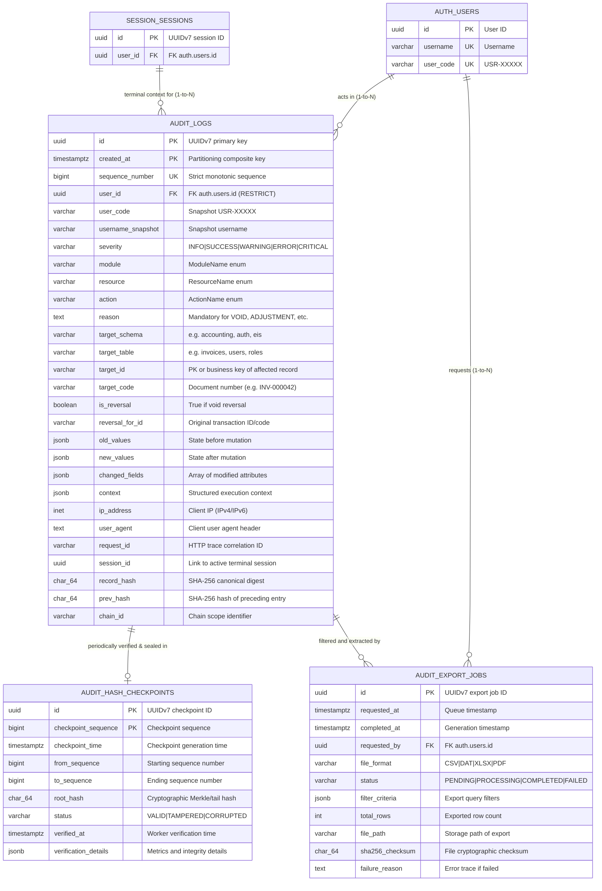

# Audit Trail Module - Entity Relationship Diagram (ERD)

This document details the database architecture of the **Audit Trail (`audit_trail`)** module (`src/modules/audit_trail/`), which enforces statutory BIR CAS activity logging (Annex B Lines 271–295, 11.i), forensic change diffing, tamper-evident cryptographic hash chaining, and report/export traceability.

---

## 1. Module ERD

---

## 2. Table Specifications

### Table: `audit_trail.audit_logs`
Primary immutable stream capturing all business mutations, security events, access modifications, and system operations.

| Field | Type | Constraints | Description & Purpose |
| :--- | :--- | :--- | :--- |
| `id` | `UUID` | **PK**, Default: `uuid7()` | Time-ordered UUIDv7 identifying the audit event. |
| `created_at` | `TIMESTAMPTZ` | **PK**, Default: `now()` | Server-generated entry timestamp in UTC. Forms composite PK with `id` for range partitioning. |
| `sequence_number` | `BIGINT` | **UK**, **INDEX**, Non-nullable | Monotonic integer from `audit_trail.audit_seq` for gap detection and cursor pagination. |
| `user_id` | `UUID` | **FK**, **INDEX**, Nullable | References `auth.users.id` with `ON DELETE RESTRICT`. Null for unauthenticated attempts. |
| `user_code` | `VARCHAR(20)` | Nullable | User code snapshot (e.g., `USR-00001`) at time of execution (Annex B Line 290). |
| `username_snapshot` | `VARCHAR(50)` | Nullable | Username snapshot at execution time; records attempted username during failed logins. |
| `severity` | `VARCHAR(20)` | **INDEX**, Non-nullable | Event severity: `INFO`, `SUCCESS`, `WARNING`, `ERROR`, `CRITICAL`. |
| `module` | `VARCHAR(50)` | **INDEX**, Non-nullable | System module originating the event (`ModuleName` enum). |
| `resource` | `VARCHAR(50)` | **INDEX**, Non-nullable | Domain entity / API resource originating the event (`ResourceName` enum). |
| `action` | `VARCHAR(50)` | **INDEX**, Non-nullable | Statutory or operational action (`ActionName` enum). |
| `reason` | `TEXT` | Nullable | Justification reason. Mandatory for `VOID`, `ADJUSTMENT`, `ROLE_CHANGE`, `SECURITY_LOCKOUT`. |
| `target_schema` | `VARCHAR(50)` | Nullable | Affected database schema (e.g., `accounting`, `auth`, `rbac`, `eis`). |
| `target_table` | `VARCHAR(100)` | **INDEX**, Nullable | Affected database table (e.g., `invoices`, `users`, `roles`). |
| `target_id` | `VARCHAR(100)` | **INDEX**, Nullable | Primary key / ID of the affected record. |
| `target_code` | `VARCHAR(100)` | **INDEX**, Nullable | Human-readable document serial or business code (`INV-000042`, `ROLE_ADMIN`). |
| `is_reversal` | `BOOLEAN` | Default: `false`, Non-nullable | True if this entry represents a reversing transaction / void (Annex B Item 10.c). |
| `reversal_for_id`| `VARCHAR(100)` | **INDEX**, Nullable | Links reversing audit record directly to original transaction ID/code. |
| `old_values` | `JSONB` | Nullable | Snapshot of record state before mutation (redacted of secrets). |
| `new_values` | `JSONB` | Nullable | Snapshot of record state after mutation (redacted of secrets). |
| `changed_fields` | `JSONB` | Nullable | Compact JSON array of modified attribute names for fast indexing and badge display. |
| `context` | `JSONB` | Nullable | Structured context (report filters, EIS rejection codes, HTTP status, client metadata). |
| `ip_address` | `INET` / `VARCHAR(45)` | Nullable | Client IP address captured from authenticated connection or trusted proxy headers. |
| `user_agent` | `TEXT` | Nullable | Raw client browser / API client user-agent string. |
| `request_id` | `VARCHAR(64)` | **INDEX**, Nullable | HTTP correlation ID (`X-Request-ID`) connecting web logs to database entries. |
| `session_id` | `UUID` | **INDEX**, Nullable | Foreign key to `session.sessions.id`, linking audit rows to active terminal sessions. |
| `record_hash` | `CHAR(64)` | Non-nullable | SHA-256 cryptographic digest of canonical row contents + `prev_hash`. |
| `prev_hash` | `CHAR(64)` | Non-nullable | SHA-256 hash of immediately preceding row in the chain. Genesis block uses 64 zeros. |
| `chain_id` | `VARCHAR(100)` | **INDEX**, Non-nullable | Hash chain scope identifier (default: `'GLOBAL'`, or entity-scoped `'invoices:INV-000042'`). |

---

### Table: `audit_trail.audit_export_jobs`
Tracks asynchronous and synchronous audit trail export requests, statutory header stamps, and file integrity checksums.

| Field | Type | Constraints | Description & Purpose |
| :--- | :--- | :--- | :--- |
| `id` | `UUID` | **PK**, Default: `uuid7()` | Time-ordered export job identifier. |
| `requested_at` | `TIMESTAMPTZ` | Default: `now()`, Non-nullable | Timestamp when export was queued. |
| `completed_at` | `TIMESTAMPTZ` | Nullable | Timestamp when export generation finished. |
| `requested_by` | `UUID` | **FK**, **INDEX**, Non-nullable | References `auth.users.id`. User who initiated the export. |
| `file_format` | `VARCHAR(10)` | Non-nullable | Export format: `CSV`, `DAT`, `XLSX`, `PDF`. |
| `status` | `VARCHAR(20)` | **INDEX**, Non-nullable | Lifecycle status: `PENDING`, `PROCESSING`, `COMPLETED`, `FAILED`. |
| `filter_criteria` | `JSONB` | Non-nullable | Exact query filters applied (date range, module, resource, user, action). |
| `total_rows` | `INTEGER` | Nullable | Total audit entries exported. |
| `file_path` | `VARCHAR(500)` | Nullable | Restricted filesystem storage path of the generated export. |
| `sha256_checksum`| `CHAR(64)` | Nullable | SHA-256 cryptographic checksum of generated file for tamper verification. |
| `failure_reason` | `TEXT` | Nullable | Detailed error trace if export job failed. |

---

### Table: `audit_trail.audit_hash_checkpoints`
Stores periodic cryptographic checkpoints (Merkle roots or tail digests) verified by scheduled verification workers.

| Field | Type | Constraints | Description & Purpose |
| :--- | :--- | :--- | :--- |
| `id` | `UUID` | **PK**, Default: `uuid7()` | Checkpoint identifier. |
| `checkpoint_sequence`| `BIGINT` | **PK**, Non-nullable | Monotonic checkpoint number. |
| `checkpoint_time`| `TIMESTAMPTZ` | Non-nullable | Timestamp of checkpoint calculation. |
| `from_sequence`  | `BIGINT` | Non-nullable | Start audit `sequence_number` of verified range. |
| `to_sequence`    | `BIGINT` | Non-nullable | End audit `sequence_number` of verified range. |
| `root_hash`      | `CHAR(64)` | Non-nullable | Merkle root or tail hash at `to_sequence`. |
| `status`         | `VARCHAR(20)` | Non-nullable | Verification status: `VALID`, `TAMPERED`, `CORRUPTED`. |
| `verified_at`    | `TIMESTAMPTZ` | Nullable | Timestamp of verification execution. |
| `verification_details` | `JSONB` | Nullable | Metrics, broken row IDs (if tampered), and external anchor sync status. |

---

## 3. Database-Level Protections & Security Invariants

1. **Unbypassable Immutability Trigger (`tg_prevent_audit_log_mutation`)**:
   - `BEFORE UPDATE OR DELETE` trigger on `audit_trail.audit_logs`.
   - Raises an unbypassable exception (`SQLSTATE 55000`) forbidding in-place mutation or purging (BIR Annex B Item 11.i).
2. **PostgreSQL Role Revocation**:
   - `REVOKE UPDATE, DELETE, TRUNCATE ON audit_trail.audit_logs FROM PUBLIC, app_role;`
   - `GRANT SELECT, INSERT ON audit_trail.audit_logs TO app_role;`
3. **Mandatory Reason Check Constraint (`ck_audit_logs_mandatory_reason`)**:
   - Enforces `reason` non-null and length $\ge 5$ characters for sensitive operations: `VOID`, `ADJUSTMENT`, `ROLE_CHANGE`, `PERMISSION_CHANGE`, `SECURITY_LOCKOUT`, `FORCED_LOGOUT`.
4. **JSON Payload Size Guard (`ck_audit_logs_payload_size`)**:
   - Max 64 KB for `context`.
   - Max 256 KB for `old_values` and `new_values` to prevent database denial-of-service.
5. **Session Rollback Isolation**:
   - Business transactions log to `audit_trail.audit_logs` using the current transaction session (rolls back atomically if business mutation fails).
   - Security violations (failed logins, lockouts, brute-force attempts) log using an isolated connection (`postgres_client_async_session()`) that commits immediately to survive request rollbacks.
