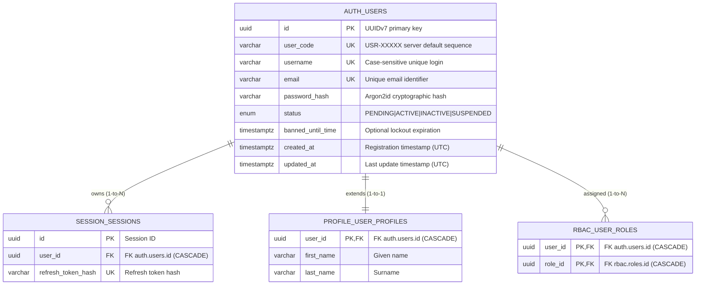

# Authentication Module - Entity Relationship Diagram (ERD)

This document details the database architecture of the **Authentication (`auth`)** module, which serves as the central identity anchor for the XCOM ERP & CAS platform.

---

## 1. Module ERD



---

## 2. Table Specifications

### Table: `auth.users`
The root table managing system credentials, identity codes, and account lifecycles.

| Field | Type | Constraints | Description & Purpose |
| :--- | :--- | :--- | :--- |
| `id` | `UUID` | **PK**, Default: `uuid7()` | Time-ordered UUIDv7 ensuring efficient B-tree index insertion and global uniqueness. |
| `user_code` | `VARCHAR(20)` | **UK**, **INDEX**, Non-nullable | Human-readable identifier formatted as `USR-XXXXX`. Generated via PostgreSQL sequence `auth.user_code_seq`. Used on physical receipts, vouchers, and UI displays. |
| `username` | `VARCHAR(50)` | **UK**, **INDEX**, Non-nullable | Unique username used for credential authentication. |
| `email` | `VARCHAR(100)` | **UK**, **INDEX**, Non-nullable | Primary contact email for password resets, 2FA, and official audit notices. |
| `password_hash` | `VARCHAR(255)` | Non-nullable | Argon2id salted password hash. Plaintext passwords are never stored. |
| `status` | `UserStatus` (Enum) | **INDEX**, Non-nullable | Account state: `PENDING` (needs approval), `ACTIVE` (standard), `INACTIVE` (deactivated), `SUSPENDED` (administrative hold). |
| `banned_until_time` | `TIMESTAMPTZ` | Nullable | Expiration timestamp for brute-force rate limit lockouts. If `now() < banned_until_time`, login attempts are rejected. |
| `created_at` | `TIMESTAMPTZ` | Non-nullable | UTC timestamp when the user registered. |
| `updated_at` | `TIMESTAMPTZ` | Non-nullable | UTC timestamp automatically updated on any field modification. |

---

## 3. Key Constraints & Database Logic

1. **Deterministic User Code Sequence (`auth.user_code_seq`)**:
   - The field `user_code` has server default:
     ```sql
     'USR-' || lpad(nextval('auth.user_code_seq')::text, 5, '0')
     ```
   - Guarantees gapless human identifiers across concurrent registrations without application-level race conditions.
2. **Account Lifecycle State Machine**:
   - Only users with `status = 'ACTIVE'` and `banned_until_time IS NULL` (or expired) are permitted to issue JWT authentication tokens.
3. **Cascading Deletions**:
   - Deleting a user in `auth.users` cascades immediately to `session.sessions`, `profile.user_profiles`, and `rbac.user_roles`.
