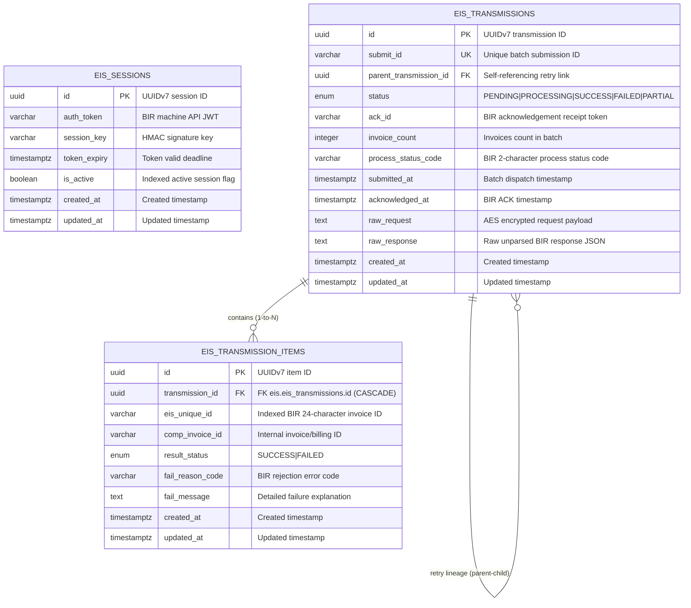

# BIR EIS Compliance Module - Entity Relationship Diagram (ERD)

This document details the database architecture of the **Electronic Invoicing System (`eis`)** module, providing BIR EIS v2.0 machine-to-machine session caching, batch transmission ledgers, retry trees, and invoice-level audit validation results.

---

## 1. Module ERD

---

## 2. Table Specifications

### Table: `eis.eis_sessions`
Audit log and token lifecycle store for BIR EIS machine-to-machine authentication sessions.

| Field | Type | Constraints | Description & Purpose |
| :--- | :--- | :--- | :--- |
| `id` | `UUID` | **PK**, Default: `uuid7()` | Time-ordered UUIDv7 identifying the session. |
| `auth_token` | `VARCHAR(500)` | Non-nullable | Issued BIR EIS JWT bearer token. |
| `session_key` | `VARCHAR(64)` | Non-nullable | Secret session key used for HMAC-SHA256 request payload signatures. |
| `token_expiry` | `TIMESTAMPTZ` | Non-nullable | Token expiration deadline. System refreshes token before this timestamp. |
| `is_active` | `BOOLEAN` | **INDEX**, Default: `true` | Indicates whether the session is currently eligible for outbound transmissions. |
| `created_at`, `updated_at` | `TIMESTAMPTZ` | Non-nullable | UTC timestamps for audit tracking. |

---

### Table: `eis.eis_transmissions`
Batch transmission audit record representing a dispatch attempt of up to 1,000 sales invoices/receipts to the BIR EIS portal.

| Field | Type | Constraints | Description & Purpose |
| :--- | :--- | :--- | :--- |
| `id` | `UUID` | **PK**, Default: `uuid7()` | Time-ordered UUIDv7 identifying the batch attempt. |
| `submit_id` | `VARCHAR(100)` | **UK**, **INDEX**, Non-nullable | Unique transmission submission identifier assigned by client system. |
| `parent_transmission_id` | `UUID` | **FK**, Nullable | References `eis.eis_transmissions.id` (`ON DELETE SET NULL`). Connects retry transmissions to their original ancestor to maintain audit continuity. |
| `status` | `EisTransmissionStatus` (Enum) | **INDEX**, Non-nullable | Lifecycle state: `PENDING`, `PROCESSING`, `SUCCESS`, `FAILED`, `PARTIAL_FAILED`. |
| `ack_id` | `VARCHAR(200)` | Nullable | Acknowledgement receipt ID returned by BIR upon successful transmission intake. |
| `invoice_count` | `INTEGER` | Non-nullable | Total count of electronic invoices encapsulated in this batch submission. |
| `process_status_code` | `VARCHAR(2)` | Nullable | BIR two-character response status code (e.g., `00` for Accepted, `01` for Rejected). |
| `submitted_at` | `TIMESTAMPTZ` | Nullable | Exact UTC time when payload was dispatched across the wire. |
| `acknowledged_at` | `TIMESTAMPTZ` | Nullable | Exact UTC time when BIR ACK response was confirmed. |
| `raw_request` | `TEXT` | Nullable | AES-encrypted request payload stored for statutory BIR non-repudiation and audit defense. |
| `raw_response` | `TEXT` | Nullable | Full verbatim JSON response returned by BIR servers. |
| `created_at`, `updated_at` | `TIMESTAMPTZ` | Non-nullable | Record lifecycle timestamps. |

---

### Table: `eis.eis_transmission_items`
Granular per-invoice validation results received from BIR inquiry API calls.

| Field | Type | Constraints | Description & Purpose |
| :--- | :--- | :--- | :--- |
| `id` | `UUID` | **PK**, Default: `uuid7()` | Time-ordered UUIDv7 identifying the item validation result. |
| `transmission_id` | `UUID` | **FK**, Non-nullable | References `eis.eis_transmissions.id` with `ON DELETE CASCADE`. Links result to batch header. |
| `eis_unique_id` | `VARCHAR(24)` | **INDEX**, Non-nullable | 24-character statutory BIR unique invoice identification string (`TIN(12) + Branch(3) + SequentialNumber(9)`). |
| `comp_invoice_id` | `VARCHAR(50)` | Nullable | Internal accounting document reference number (e.g. Sales Invoice or Official Receipt number). |
| `result_status` | `EisResultStatus` (Enum) | Non-nullable | Invoice outcome: `SUCCESS` or `FAILED`. |
| `fail_reason_code` | `VARCHAR(10)` | Nullable | Specific BIR error reason code (e.g., `E01`, `E14`). |
| `fail_message` | `TEXT` | Nullable | Plaintext BIR error description detailing validation failures (e.g. invalid buyer TIN). |
| `created_at`, `updated_at` | `TIMESTAMPTZ` | Non-nullable | Record lifecycle timestamps. |

---

## 3. Regulatory Invariants & Audit Guarantees

1. **Non-Repudiation Storage (`raw_request` & `raw_response`)**:
   - Mandated by BIR RR No. 8-2022 and RMO No. 24-2023. Raw transmitted encrypted payloads and official BIR server responses are permanently retained for tax examination.
2. **Re-transmission Lineage (`parent_transmission_id`)**:
   - When a partial or failed batch is corrected and re-submitted, the new transmission points back to the failed transmission, preventing duplicate tax accounting while preserving failure history.
3. **24-Character `eis_unique_id` Indexing**:
   - B-tree indexed to support rapid audit reconciliation between internal accounting journals and BIR EIS clearance logs.
