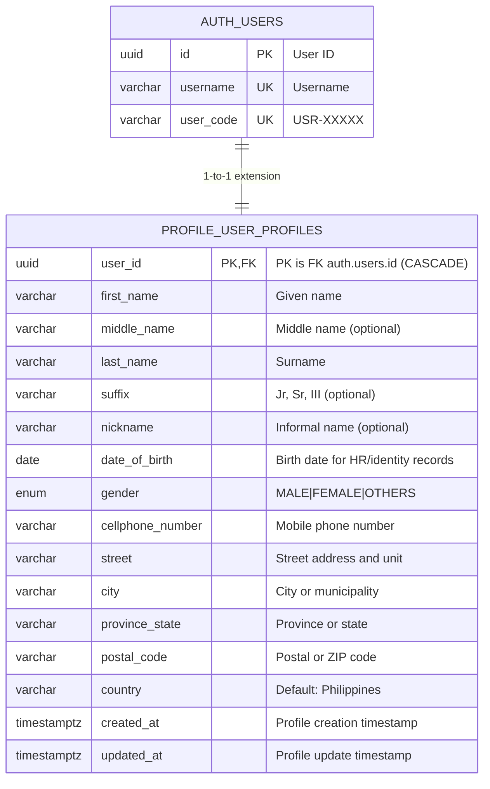

# User Profile Module - Entity Relationship Diagram (ERD)

This document details the database architecture of the **Profile (`profile`)** module, providing personal identification and structured address storage as a strict 1-to-1 extension of user credentials.

---

## 1. Module ERD

---

## 2. Table Specifications

### Table: `profile.user_profiles`
Personal demographic details, phone numbers, and physical residential/business addresses.

| Field | Type | Constraints | Description & Purpose |
| :--- | :--- | :--- | :--- |
| `user_id` | `UUID` | **PK**, **FK** | References `auth.users.id` with `ON DELETE CASCADE`. Serves as both Primary Key and Foreign Key, enforcing a strict 1-to-1 relationship. |
| `first_name` | `VARCHAR(50)` | Non-nullable | Legal given name of the user. |
| `middle_name` | `VARCHAR(50)` | Nullable | Legal middle name. |
| `last_name` | `VARCHAR(50)` | Non-nullable | Legal family surname. |
| `suffix` | `VARCHAR(10)` | Nullable | Name suffix (e.g., Jr., Sr., III, CPA). |
| `nickname` | `VARCHAR(50)` | Nullable | Preferred alias for informal notifications and greetings. |
| `date_of_birth` | `DATE` | Nullable | Date of birth for organizational HR records and identity verification. |
| `gender` | `UserGender` (Enum) | Non-nullable | Biological or administrative gender (`MALE`, `FEMALE`, `OTHERS`). |
| `cellphone_number` | `VARCHAR(20)` | Non-nullable | Primary mobile number for SMS 2FA notifications and company contact. |
| `street` | `VARCHAR(150)` | Nullable | Building number, street address, and barangay/district. |
| `city` | `VARCHAR(100)` | Nullable | City or municipality. |
| `province_state` | `VARCHAR(100)` | Nullable | Province, region, or state. |
| `postal_code` | `VARCHAR(20)` | Nullable | Postal or ZIP code. |
| `country` | `VARCHAR(100)` | Default: `'Philippines'`, Nullable | Country of residence. |
| `created_at` | `TIMESTAMPTZ` | Non-nullable | Record creation timestamp in UTC. |
| `updated_at` | `TIMESTAMPTZ` | Non-nullable | Record modification timestamp in UTC. |

---

## 3. Structural Constraints & Invariants

1. **Strict 1-to-1 Relationship**:
   - `user_id` is both the primary key and foreign key. A user cannot have multiple profile records, and a profile cannot exist without a parent user.
2. **Separation of Concerns**:
   - Authentication secrets (`password_hash`, tokens) are cleanly decoupled from PII (Personally Identifiable Information) in `profile`, facilitating compliance with Philippine Data Privacy Act (DPA) requirements.
3. **Cascading Lifecycle**:
   - Purging an identity from `auth.users` automatically deletes its corresponding `user_profiles` record.
