# RBAC & Authorization Module - Entity Relationship Diagram (ERD)

This document details the database architecture of the **Role-Based Access Control (`rbac`)** module, including granular permissions, dual-authorization approval workflows, and immutable point-in-time audit snapshot ledgers.

---

## 1. Module ERD

```mermaid
erDiagram
    AUTH_USERS {
        uuid id PK "User ID"
        varchar username UK "Username"
        varchar user_code UK "USR-XXXXX"
    }

    RBAC_ROLES {
        uuid id PK "UUIDv7 role ID"
        varchar name UK "Role name"
        varchar description "Role summary"
        boolean is_system_role "Immutable system role flag"
        timestamptz created_at "Created timestamp"
        timestamptz updated_at "Updated timestamp"
    }

    RBAC_PERMISSIONS {
        uuid id PK "UUIDv7 permission ID"
        varchar code UK "Standard code e.g. accounting:post"
        varchar module "Indexed module category"
        varchar name "Permission name"
        varchar description "Permission scope description"
        timestamptz created_at "Created timestamp"
        timestamptz updated_at "Updated timestamp"
    }

    RBAC_ROLE_PERMISSIONS {
        uuid role_id PK,FK "FK rbac.roles.id (CASCADE)"
        uuid permission_id PK,FK "FK rbac.permissions.id (CASCADE)"
        timestamptz created_at "Association timestamp"
    }

    RBAC_USER_ROLES {
        uuid user_id PK,FK "FK auth.users.id (CASCADE)"
        uuid role_id PK,FK "FK rbac.roles.id (CASCADE)"
        timestamptz created_at "Assignment timestamp"
        timestamptz updated_at "Updated timestamp"
    }

    RBAC_USER_PERMISSIONS {
        uuid user_id PK,FK "FK auth.users.id (CASCADE)"
        uuid permission_id PK,FK "FK rbac.permissions.id (CASCADE)"
        boolean is_granted "Explicit grant (true) / deny (false)"
        uuid assigned_by_id FK "FK auth.users.id (SET NULL)"
        varchar reason "Mandatory business justification"
        timestamptz created_at "Grant timestamp"
        timestamptz updated_at "Updated timestamp"
    }

    RBAC_CHANGE_REQUESTS {
        uuid id PK "UUIDv7 change request ID"
        varchar request_type "ROLE_ASSIGNMENT|DIRECT_PERMISSION"
        uuid target_user_id FK "FK auth.users.id (CASCADE)"
        uuid target_role_id FK "FK rbac.roles.id (CASCADE)"
        varchar requested_payload "JSON serialized modification"
        enum status "PENDING|APPROVED|REJECTED"
        varchar reason "Requester justification"
        uuid requested_by_id FK "FK auth.users.id (CASCADE)"
        uuid reviewed_by_id FK "FK auth.users.id (SET NULL)"
        varchar review_notes "Approver notes"
        timestamptz reviewed_at "Decision timestamp"
        timestamptz created_at "Submission timestamp"
        timestamptz updated_at "Updated timestamp"
    }

    RBAC_ROLE_PERMISSION_SNAPSHOTS {
        uuid id PK "UUIDv7 snapshot ID"
        uuid role_id FK "FK rbac.roles.id (CASCADE)"
        json permissions_payload "Immutable [{id, code}] array"
        uuid changed_by_id FK "FK auth.users.id (SET NULL)"
        varchar reason "Change justification"
        timestamptz created_at "Snapshot timestamp"
        timestamptz updated_at "Updated timestamp"
    }

    RBAC_USER_RBAC_SNAPSHOTS {
        uuid id PK "UUIDv7 snapshot ID"
        uuid user_id FK "FK auth.users.id (CASCADE)"
        json roles_payload "Immutable roles array"
        json direct_permissions_payload "Direct grants array"
        json effective_permissions_payload "Resolved permissions array"
        uuid changed_by_id FK "FK auth.users.id (SET NULL)"
        varchar reason "Change justification"
        timestamptz created_at "Snapshot timestamp"
        timestamptz updated_at "Updated timestamp"
    }

    AUTH_USERS ||--o{ RBAC_USER_ROLES : "assigned"
    AUTH_USERS ||--o{ RBAC_USER_PERMISSIONS : "receives"
    AUTH_USERS ||--o{ RBAC_CHANGE_REQUESTS : "initiates/targets"
    AUTH_USERS ||--o{ RBAC_USER_RBAC_SNAPSHOTS : "historical audit"

    RBAC_ROLES ||--o{ RBAC_ROLE_PERMISSIONS : "contains"
    RBAC_PERMISSIONS ||--o{ RBAC_ROLE_PERMISSIONS : "belongs to"
    RBAC_ROLES ||--o{ RBAC_USER_ROLES : "mapped to"
    RBAC_PERMISSIONS ||--o{ RBAC_USER_PERMISSIONS : "direct rule"
    RBAC_ROLES ||--o{ RBAC_ROLE_PERMISSION_SNAPSHOTS : "history"
```

---

## 2. Table Specifications

### 2.1 Core Authorization Catalog

#### Table: `rbac.roles`
Defines grouping containers for sets of permissions.
- `id` (`UUID`, PK): Time-ordered UUIDv7.
- `name` (`VARCHAR(100)`, UK, INDEX): Unique human-readable role name (e.g. `ACCOUNTING_MANAGER`, `AUDITOR`).
- `description` (`VARCHAR(255)`, Nullable): Purpose and operational scope.
- `is_system_role` (`BOOLEAN`, Non-nullable): System roles cannot be renamed or deleted via API.

#### Table: `rbac.permissions`
Atomic capability definitions adhering to hierarchical naming (`<domain>:<entity>:<action>`).
- `id` (`UUID`, PK): Time-ordered UUIDv7.
- `code` (`VARCHAR(100)`, UK, INDEX): Unique string identifier (e.g. `accounting:journal:post`, `eis:invoice:transmit`).
- `module` (`VARCHAR(50)`, INDEX): Subsystem category for indexed UI filtering.
- `name` (`VARCHAR(100)`): Human-readable permission title.
- `description` (`VARCHAR(255)`, Nullable): Explains the access granted.

---

### 2.2 Junction & Assignment Tables

#### Table: `rbac.role_permissions`
Many-to-Many association linking roles to permissions.
- `role_id` (`UUID`, PK, FK): References `rbac.roles.id` with `CASCADE`.
- `permission_id` (`UUID`, PK, FK): References `rbac.permissions.id` with `CASCADE`.
- `created_at` (`TIMESTAMPTZ`): UTC assignment timestamp.

#### Table: `rbac.user_roles`
Many-to-Many association linking users to roles.
- `user_id` (`UUID`, PK, FK): References `auth.users.id` with `CASCADE`.
- `role_id` (`UUID`, PK, FK): References `rbac.roles.id` with `CASCADE`.
- `created_at`, `updated_at` (`TIMESTAMPTZ`): Lifecycle audit timestamps.

#### Table: `rbac.user_permissions`
Direct user overrides for granular permission assignment or revocation.
- `user_id` (`UUID`, PK, FK): References `auth.users.id` with `CASCADE`.
- `permission_id` (`UUID`, PK, FK): References `rbac.permissions.id` with `CASCADE`.
- `is_granted` (`BOOLEAN`): `true` for explicit grant, `false` for explicit deny/override.
- `assigned_by_id` (`UUID`, FK): References `auth.users.id` with `ON DELETE SET NULL`. Identifies the granting administrator.
- `reason` (`VARCHAR(255)`): Mandatory explanation for the direct grant/denial.

---

### 2.3 Dual-Authorization Workflow

#### Table: `rbac.rbac_change_requests`
Two-person integrity governance for sensitive privilege modifications.
- `id` (`UUID`, PK): Time-ordered UUIDv7.
- `request_type` (`VARCHAR(50)`): Type of change (`ROLE_ASSIGNMENT`, `DIRECT_PERMISSION`).
- `target_user_id` (`UUID`, FK): References `auth.users.id` with `CASCADE`.
- `target_role_id` (`UUID`, FK): References `rbac.roles.id` with `CASCADE`.
- `requested_payload` (`VARCHAR(2000)`): Serialized configuration proposed for application upon approval.
- `status` (`RBACChangeRequestStatus` Enum, INDEX): `PENDING`, `APPROVED`, or `REJECTED`.
- `reason` (`VARCHAR(255)`): Requester's operational justification.
- `requested_by_id` (`UUID`, FK): References `auth.users.id` with `CASCADE`. The administrator proposing the change.
- `reviewed_by_id` (`UUID`, FK): References `auth.users.id` with `ON DELETE SET NULL`. The independent approving administrator.
- `review_notes` (`VARCHAR(255)`, Nullable): Approver or rejecter commentary.
- `reviewed_at` (`TIMESTAMPTZ`, Nullable): UTC timestamp when approval/rejection was executed.

---

### 2.4 Immutable Audit Snapshot Ledgers

#### Table: `rbac.role_permission_snapshots`
Point-in-time snapshot capturing the full permission set of a role whenever modified.
- `id` (`UUID`, PK): UUIDv7.
- `role_id` (`UUID`, FK, INDEX): References `rbac.roles.id` with `CASCADE`.
- `permissions_payload` (`JSON`): Complete serialized list of `[{id, code}]` at that exact millisecond.
- `changed_by_id` (`UUID`, FK): References `auth.users.id` with `ON DELETE SET NULL`.
- `reason` (`VARCHAR(255)`): Reason for role revision.
- Composite Index: `ix_rbac_role_snapshots_role_created` on `(role_id, created_at)`.

#### Table: `rbac.user_rbac_snapshots`
Point-in-time snapshot capturing the user's effective permissions, direct permissions, and assigned roles.
- `id` (`UUID`, PK): UUIDv7.
- `user_id` (`UUID`, FK, INDEX): References `auth.users.id` with `CASCADE`.
- `roles_payload` (`JSON`): List of roles held by user at snapshot time.
- `direct_permissions_payload` (`JSON`): List of direct grants/denials.
- `effective_permissions_payload` (`JSON`): Fully resolved effective permissions.
- `changed_by_id` (`UUID`, FK): References `auth.users.id` with `ON DELETE SET NULL`.
- `reason` (`VARCHAR(255)`): Reason for privilege modification.
- Composite Index: `ix_rbac_user_snapshots_user_created` on `(user_id, created_at)`.

---

## 3. Governance & Security Invariants

1. **Dual Authorization (Maker-Checker)**:
   - Changes to privileged roles or direct user grants must be committed through `rbac_change_requests` where `requested_by_id != reviewed_by_id`.
2. **Immutability of Snapshot Records**:
   - `role_permission_snapshots` and `user_rbac_snapshots` are insert-only tables with no update or delete endpoints, providing tamper-resistant proof of historic access rights for internal security auditors and enterprise compliance frameworks.
3. **Audit Trail Retention (`ON DELETE SET NULL`)**:
   - `assigned_by_id`, `reviewed_by_id`, and `changed_by_id` remain preserved even if the administrator's account is subsequently deleted.
