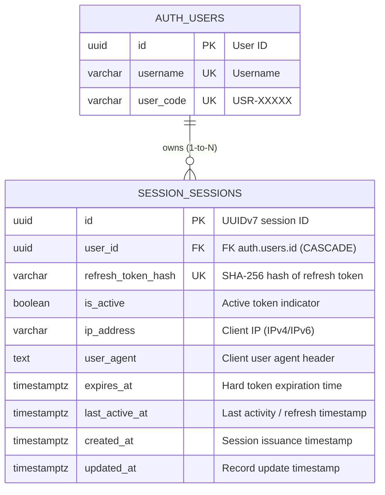

# Session Module - Entity Relationship Diagram (ERD)

This document details the database architecture of the **Session (`session`)** module, which manages multi-device refresh token lifecycles, active session revocation, and security audit records.

---

## 1. Module ERD

---

## 2. Table Specifications

### Table: `session.sessions`
Historical session audit log and persistent storage for active refresh tokens.

| Field | Type | Constraints | Description & Purpose |
| :--- | :--- | :--- | :--- |
| `id` | `UUID` | **PK**, Default: `uuid7()` | Time-ordered UUIDv7 identifying the session instance. |
| `user_id` | `UUID` | **FK**, **INDEX**, Non-nullable | References `auth.users.id` with `ON DELETE CASCADE`. Links the session to the authenticated user. |
| `refresh_token_hash` | `VARCHAR(255)` | **UK**, **INDEX**, Non-nullable | SHA-256 hash of the issued refresh token. The raw token is stored only in client HTTP-Only cookies to eliminate plain token leaks. |
| `is_active` | `BOOLEAN` | Default: `true`, Non-nullable | State flag. Set to `false` when the user logs out or when a session is revoked administratively. |
| `ip_address` | `VARCHAR(45)` | Nullable | Client IP address at session creation (supports IPv4 and IPv6). Used for geolocation security analysis. |
| `user_agent` | `TEXT` | Nullable | Browser/device User-Agent string to distinguish mobile, desktop, or API client sessions. |
| `expires_at` | `TIMESTAMPTZ` | Non-nullable | Absolute expiry timestamp of the refresh token. Expired sessions are ineligible for rotation. |
| `last_active_at` | `TIMESTAMPTZ` | Non-nullable | Updated each time the refresh token is used to issue a new short-lived access token. |
| `created_at` | `TIMESTAMPTZ` | Non-nullable | UTC timestamp when the session was created. |
| `updated_at` | `TIMESTAMPTZ` | Non-nullable | UTC timestamp of last record mutation. |

---

## 3. Performance Indexes & Security Invariants

1. **Composite Lookup Index (`ix_session_sessions_user_active`)**:
   - Indexed on `(user_id, is_active)`.
   - **Purpose**: Enables immediate $O(1)$ querying when fetching all active devices for a user or revoking all sessions upon password reset.
2. **Cryptographic One-Way Storage**:
   - Only `refresh_token_hash` is retained in the database. Compromise of the database does not grant attackers valid refresh tokens.
3. **Session Revocation Behavior**:
   - Setting `is_active = false` immediately invalidates the session chain. Any subsequent attempt to present the matching refresh token triggers security blacklisting in Redis.
